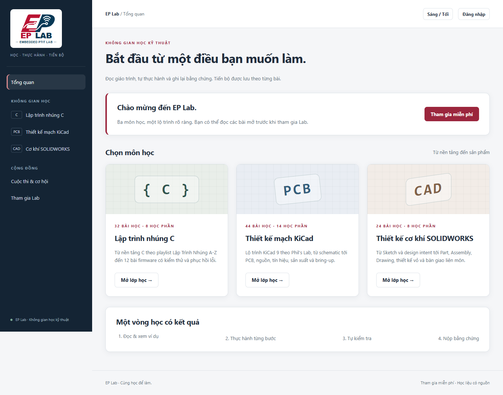

# EP Lab Rust

Bản web độc lập của [EP Lab](https://github.com/ekt0810/EPlab), dùng **Rust cho API và dựng HTML**, PostgreSQL cho dữ liệu, CSS và JavaScript thuần cho tương tác trình duyệt. Website chạy bằng một chương trình native; không cần Node.js để phục vụ web.

Đây là phiên bản 0.1 cho mô hình Lab miễn phí. Mã TypeScript và database của bản cũ được giữ riêng. Không thể dùng chung schema hay trỏ bản Rust vào database đang chạy của bản cũ.



## Đã có

- Đăng ký, xác minh email, đăng nhập, khôi phục/đổi mật khẩu, thư mời và quản lý phiên.
- Hai vị trí người chủ trì; quản lý tài khoản, ghi chú hỗ trợ, khóa/mở khóa, thu hồi phiên và nhật ký.
- Tham gia Lab miễn phí, duyệt trực tiếp, từ chối/thu hồi có lý do, chống ghi đè quyết định cũ.
- Ba môn, **100 bài học**, giáo trình PDF, nguồn video, tiến độ, ghi chú, tự kiểm và tra cứu giáo trình có dẫn nguồn.
- Sửa/xuất bản học liệu, tệp bổ sung, **36 bài thực hành**, giao bài, nộp ảnh/tệp nguồn, chấm theo rubric và giữ lịch sử.
- Trao đổi riêng giữa học viên và người chủ trì; đăng/ẩn thông tin cuộc thi.
- Giao diện desktop/mobile, sáng/tối, điều hướng bàn phím.

Xem [đối chiếu chức năng](docs/FEATURES.md) để biết các khác biệt: chưa chuyển MFA, AI ngoài hệ thống, thanh toán cũ, lưu trữ S3 và các công cụ vận hành riêng của bản TypeScript. Không coi đây là bản thay thế tương đương 100% tính năng.

## Kết quả kiểm chứng

- 4 unit test Rust.
- 70 test API chạy trên PostgreSQL thật, với database tạm riêng.
- 41 kiểm tra trình duyệt thực tế ở desktop/mobile.
- Cargo format, Clippy không cảnh báo, build release.
- [Báo cáo hiệu năng và phương pháp đo](docs/BENCHMARK.md), kèm dữ liệu thô trước/sau tối ưu.

## Chạy từ mã nguồn

Cần Rust **1.100+**, PostgreSQL **16+** (đã kiểm chứng với 18.6), và một database mới.

Trên Windows dùng Rust MSVC với Visual Studio C++ Build Tools. Trên Linux cần công cụ build C, pkg-config và thư viện phát triển OpenSSL. Target Windows GNU LLVM cũng được hỗ trợ khi có LLVM-MinGW và các import library Windows phù hợp.

```sh
cargo build --release --locked
cp .env.example .env
```

Sửa DATABASE_URL trong .env thành database riêng. Các giá trị mặc định khác dùng http://127.0.0.1:3200, lưu tệp tại data/ và ghi email thử nghiệm tại data/mail/.

```sh
# Linux/macOS
./target/release/eplab-rust serve
```

```powershell
# Windows, chạy tại thư mục dự án
.\target\release\eplab-rust.exe serve
```

Mở **http://127.0.0.1:3200**. Lần đầu chạy tự áp dụng migration và nạp học liệu. Seed chỉ chạy một lần, không ghi đè sửa đổi và không khôi phục bài đã xóa.

Các lệnh riêng: migrate, seed, admin. Khi chạy binary ở thư mục khác, phải đem theo thư mục content/handbooks và cấu hình .env/DATA_DIR phù hợp.

### Database thử nghiệm nhanh trên Windows

Node.js 24 chỉ cần cho các công cụ phát triển/kiểm thử:

```sh
npm ci
npm run db:start
```

Script tạo PostgreSQL riêng trên cổng 55439, sinh mật khẩu ngẫu nhiên và .env nếu chưa có. Không sửa database của EP Lab cũ. Dừng bằng npm run db:stop sau khi đã dừng website.

### Tạo người chủ trì

```powershell
powershell -ExecutionPolicy Bypass -File scripts/create-admin.ps1
```

Script hỏi email, tên, mật khẩu có che ký tự. Trên các hệ điều hành khác, đặt ADMIN_EMAIL, ADMIN_NAME, ADMIN_PASSWORD trong môi trường riêng rồi chạy eplab-rust admin; xóa biến mật khẩu sau khi tạo. Tối đa hai người chủ trì. Lệnh không nâng quyền hay ghi đè tài khoản đã tồn tại.

Trong chế độ local, thư xác minh/thư mời nằm trong DATA_DIR/mail; liên kết chỉ dùng một lần và hết hạn sau 30 phút. Thư mục này không được phục vụ qua HTTP và không được đưa lên Git.

### Hosting

Đặt APP_URL thành origin HTTPS, MAIL_MODE=smtp và cấu hình SMTP theo .env.example. Reverse proxy trỏ vào BIND_ADDR; phục vụ cùng một origin cho HTML/API. Lưu PostgreSQL và DATA_DIR trên storage bền vững, sao lưu cả hai.

Phiên bản này dùng PostgreSQL trên loopback/mạng riêng; chưa tích hợp kết nối PostgreSQL TLS từ xa, proxy-aware IP, MFA và công cụ backup/restore tự động. [Chi tiết bảo mật và vận hành](docs/SECURITY.md). Không có thao tác tự deploy trong repository.

## Kiểm thử lại

```sh
cargo fmt --check
cargo clippy --all-targets -- -D warnings
cargo test --locked
cargo build --release --locked
npm ci
npm run db:start
npm test
npm run test:browser
```

Trên Windows kiểm thử dùng Edge có sẵn. Trên Linux chạy npx playwright install --with-deps chromium trước. Có thể đặt TEST_DATABASE_URL tới PostgreSQL **local dành riêng cho test**, với quyền tạo database. Harness tạo tên ngẫu nhiên, chạy server trên cổng trống rồi xóa đúng database tạm khi hoàn tất. Không dùng tài khoản/dữ liệu thật.

Ảnh và kết quả trình duyệt nằm trong test-results/; dữ liệu/email test nằm trong work/ và không được commit.

## Cấu trúc

| Thư mục                                     | Trách nhiệm                            |
| ------------------------------------------- | -------------------------------------- |
| src/auth.rs, security.rs, mail.rs           | Tài khoản, phiên, CSRF, hạn mức, email |
| src/membership.rs, admin.rs                 | Quyền Lab và quản lý                   |
| src/catalog.rs                              | Học liệu, tiến độ, tự kiểm, tra cứu    |
| src/practice.rs, files.rs, conversations.rs | Thực hành, bằng chứng và trao đổi      |
| src/pages/                                  | HTML dựng tại server bằng Maud         |
| static/                                     | CSS, JavaScript tương tác, logo        |
| migrations/                                 | Schema có checksum                     |
| content/                                    | Học liệu nhập từ bản gốc và PDF        |
| tests/, scripts/                            | Kiểm chứng và benchmark tái lập        |

Nguồn học liệu và phạm vi sử dụng: [NOTICE.md](NOTICE.md).
